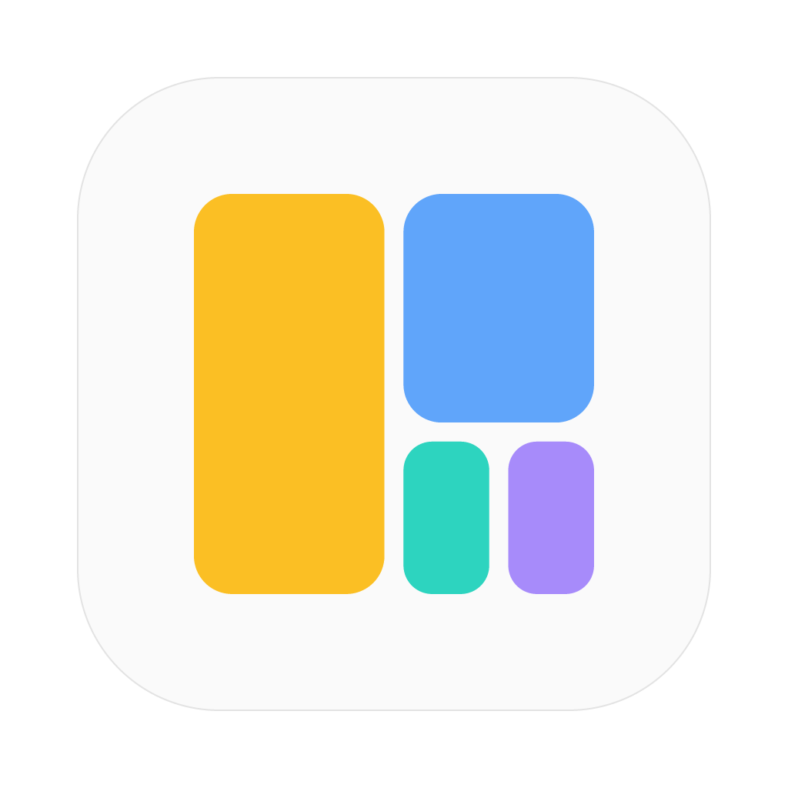
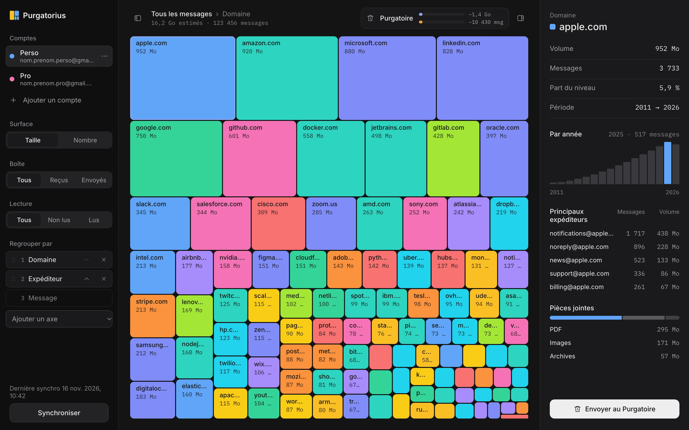

  

# Purgatorius

Application de bureau libre pour faire le ménage dans une boîte Gmail. Un
treemap interactif montre où passent la place et le bruit (par domaine,
expéditeur, titre, période, libellé...) : on zoome dans les blocs, puis on met
une sélection à la corbeille.

Deux usages, une seule vue, par bascule de la métrique de surface :

- **libérer du quota** : surface = taille des messages ;
- **désencombrer** : surface = nombre de messages.

L'axe **Libellés** utilise les libellés personnels de Gmail, avec un groupe
« Sans libellé personnel ». Un message peut apparaître dans plusieurs groupes :
leurs nombres et tailles ne s'additionnent pas. Chaque groupe, y compris
« Autres », les totaux et le Purgatoire comptent chaque message une seule fois.

## Aperçu

  

## Principes

- Accès à Gmail par IMAP, avec un mot de passe d'application (il demande la
  validation en deux étapes du compte Google). Il est rangé dans le trousseau
  du système ; sous Linux sans trousseau, dans un fichier lisible par vous
  seul. Aucun serveur tiers, aucune donnée ne quitte l'ordinateur en dehors
  des échanges avec Gmail.
- Cache local SQLite des seules métadonnées (expéditeur, destinataires, objet,
  date, taille, libellés, type et taille des pièces jointes), jamais du corps
  des messages. La lecture ne marque aucun message comme lu.
- Seule action : la mise à la corbeille des messages réunis dans le
  Purgatoire, récupérables 30 jours dans la corbeille de Gmail.

Projet indépendant, sans lien avec Google. « Gmail » est une marque de son
titulaire, employée ici à titre descriptif pour désigner le service avec
lequel ce logiciel interopère.

## Téléchargement

Les binaires sont publiés sur la page des
[releases](https://github.com/louis49/purgatorius/releases) :

| Système | Fichier |
|---|---|
| macOS 13 et plus (Apple Silicon et Intel) | `Purgatorius-macos.dmg` |
| Windows (x86-64) | `purgatorius-windows-amd64.exe` |
| Windows (ARM64) | `purgatorius-windows-arm64.exe` |
| Linux (x86-64) | `purgatorius-linux-amd64.tar.gz` |
| Linux (ARM64) | `purgatorius-linux-arm64.tar.gz` |

Chaque release fournit aussi `SHA256SUMS`, les sommes de contrôle des
fichiers, calculées par la CI qui les a compilés. Pour vérifier un
téléchargement, dans le dossier où se trouvent le fichier et `SHA256SUMS` :

    shasum -a 256 --ignore-missing -c SHA256SUMS      # macOS
    sha256sum --ignore-missing -c SHA256SUMS          # Linux
    Get-FileHash .\purgatorius-windows-amd64.exe      # Windows (PowerShell), à comparer à la ligne du fichier

## Applications non signées : lever la protection de l'OS

Les binaires **ne sont ni signés ni notarisés**. Chaque système bloque donc
l'application au premier lancement, le temps que vous l'autorisiez
explicitement.

### macOS

Ouvrir `Purgatorius-macos.dmg`, puis glisser **Purgatorius** sur le raccourci
**Applications** dans la fenêtre qui s'affiche. L'application est universelle
(Mac Intel et Apple Silicon) et demande macOS 13 ou plus récent.

Téléchargée depuis Internet, elle est mise en quarantaine : au premier
lancement, macOS refuse de l'ouvrir. Deux voies :

- **Interface** : aller dans **Réglages Système > Confidentialité et
  sécurité**, section « Sécurité », puis **« Ouvrir quand même »**, et
  confirmer. (Depuis macOS 15, le clic droit > Ouvrir ne suffit plus pour une
  application non notarisée.)
- **Terminal** : retirer l'attribut de quarantaine de l'application copiée,
  puis la lancer normalement.

      xattr -dr com.apple.quarantine /Applications/Purgatorius.app

### Windows

SmartScreen affiche « Windows a protégé votre ordinateur ». Cliquer sur
**« Informations complémentaires »**, puis **« Exécuter quand même »**.

Alternative : clic droit sur le `.exe` > **Propriétés** > cocher
**« Débloquer »** en bas de l'onglet Général > Appliquer. Ou en PowerShell :

    Unblock-File .\purgatorius-windows-amd64.exe   # ou purgatorius-windows-arm64.exe

L'application s'affiche avec le moteur WebView2 de Microsoft, présent de base
sur Windows 10 et 11. S'il manque (certaines éditions LTSC, Server ou « N »),
il faut l'installer : Wails le propose au premier lancement, avec une
connexion Internet.

### Linux

Aucune notarisation. L'archive (`purgatorius-linux-amd64.tar.gz` ou
`purgatorius-linux-arm64.tar.gz` selon l'architecture) contient le binaire, un
lanceur et une icône ; installation pour l'utilisateur courant :

    tar -xzf purgatorius-linux-amd64.tar.gz            # ou purgatorius-linux-arm64.tar.gz
    install -Dm755 purgatorius/purgatorius         ~/.local/bin/purgatorius
    install -Dm644 purgatorius/purgatorius.png     ~/.local/share/icons/hicolor/512x512/apps/purgatorius.png
    install -Dm644 purgatorius/purgatorius.desktop ~/.local/share/applications/purgatorius.desktop

Purgatorius apparaît alors dans le lanceur d'applications (ou :
`~/.local/bin/purgatorius`).

Le binaire s'appuie sur les bibliothèques du système pour sa fenêtre (GTK 3,
WebKitGTK 4.1). Il est construit pour Ubuntu 22.04 et suivantes, Debian 12 et
suivantes. Paquets nécessaires :

    sudo apt install libgtk-3-0 libwebkit2gtk-4.1-0

## Compiler depuis les sources

Purgatorius est une application [Wails](https://wails.io) v2 : le front (Vue 3
et Vite) est construit puis embarqué dans le binaire Go par `wails build`.

Prérequis :

- [Go](https://go.dev) (version dans [go.mod](go.mod)) et [Node.js](https://nodejs.org) 22 ou plus récent ;
- le CLI Wails : `go install github.com/wailsapp/wails/v2/cmd/wails@v2.17.1` ;
- Linux : `sudo apt install build-essential pkg-config libgtk-3-dev libwebkit2gtk-4.1-dev` ;
- macOS : les outils en ligne de commande Xcode (`xcode-select --install`).

`wails doctor` vérifie l'installation. Puis :

    git clone https://github.com/louis49/purgatorius
    cd purgatorius
    wails dev                                    # développement (rechargement à chaud)
    wails build                                  # macOS, Windows
    wails build -tags webkit2_41                 # Linux (WebKitGTK 4.1)
    wails build -platform darwin/universal       # macOS Intel + Apple Silicon
    scripts/dmg.sh Purgatorius-macos.dmg         # macOS : image disque
    go test ./...                                # tests (Linux : -tags webkit2_41)

Le résultat est dans `build/bin/`.

Pour vérifier un thème sans changer celui du système, la variable
`PURGATORIUS_THEME` (`clair` ou `sombre`) force l'apparence de l'app :

    open --env PURGATORIUS_THEME=clair build/bin/Purgatorius.app   # macOS
    PURGATORIUS_THEME=sombre build/bin/purgatorius                 # Linux

## Soutenir le projet

Le projet est gratuit et libre. Si vous souhaitez le soutenir :

- [PayPal](https://www.paypal.com/donate/?hosted_button_id=B8NGNPFGK69BY)
- [Buy Me a Coffee](https://www.buymeacoffee.com/louis49github)

## Licence

AGPL-3.0-or-later. Voir [LICENSE](LICENSE).
